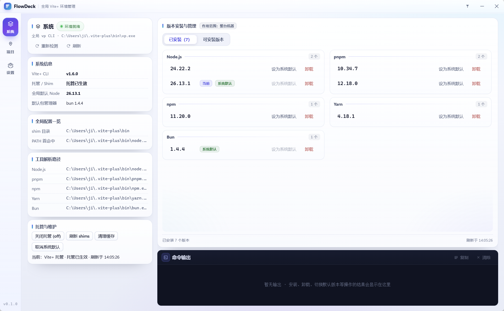
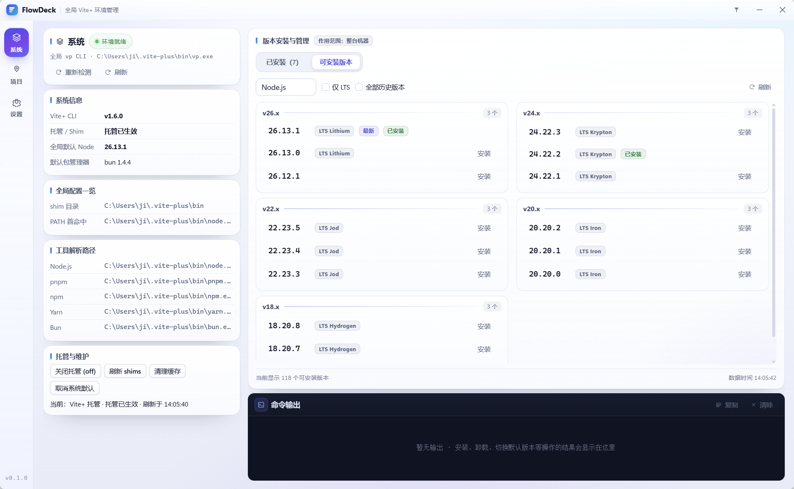

# FlowDeck

**把 Vite+ 的 `vp env` 变成桌面上的可视化操作。**

FlowDeck 是一个基于 **Tauri 2** 的 Windows 桌面工具，专注 **Vite+ 环境管理**：系统级工具链版本安装 / 卸载 / 默认切换、项目级版本固定（pin）、PATH 与 shim 审计。免安装，双击即用。

| 项       | 说明                                                                                |
| -------- | ----------------------------------------------------------------------------------- |
| 形态     | Windows 桌面应用，固定 1520×940 窗口，自绘标题栏，支持置顶与拖动                    |
| 分发     | 单个免安装 exe（约 3.6 MB），除系统自带 WebView2 外无额外运行时依赖                 |
| 前置条件 | 本机装有 **Vite+ ≥ 1.5.1**；未安装时系统页只显示安装 / 修复引导                     |
| 数据     | 全部留在本机：`%APPDATA%\dev.flowdeck.app\config.json` 与浏览器本地存储，不联网上报 |
| 许可     | MIT                                                                                 |

## 目录

**了解产品** · [一分钟了解](#一分钟了解) · [界面预览](#界面预览) · [功能详解](#功能详解) · [命令与界面速查](#命令与界面速查)

**开发参考** · [技术栈与架构](#技术栈与架构) · [数据与配置](#数据与配置) · [快速开始](#快速开始) · [项目结构](#项目结构) · [开发与调试](#开发与调试) · [打包分发](#打包分发) · [已知依赖问题](#已知依赖问题)

## 一分钟了解

三个页面按**作用范围**划分：

| 页面 | 作用范围 | 主要能力                                                             |
| ---- | -------- | -------------------------------------------------------------------- |
| 系统 | 整台机器 | 环境自检、版本安装 / 卸载、切换全局默认、托管与 shim 维护、PATH 审计 |
| 项目 | 所选目录 | 解析项目环境、固定 / 取消固定 Node 与包管理器、安装项目环境与依赖    |
| 设置 | 应用自身 | 主题、窗口置顶、vp 可执行文件探测、数据目录、关于                    |

三条贯穿全应用的设计约束：

- **不做静默改写**：启动自检只读；安装、升级、托管切换等写操作必须由用户点击触发
- **写前可预览、写后有备份**：pin / unpin 先给出文件级变更预览，执行前自动备份被改文件
- **失败不卡死**：所有 `vp` 子进程都有分级超时、进程树取消、失败分类与重试入口

## 界面预览

> 界面截图统一放在 [docs/](docs/) 目录，本文档全部使用相对路径引用。

**系统页** —— 左栏是系统状态与审计，右栏是版本安装与管理，底部常驻「命令输出」：



切换到「可安装版本」后，远端版本按大版本分组展示：



**项目页** —— 顶部常驻当前项目路径，所有查询与写入都限定在这个目录：


**设置页** —— 外观、启动与窗口、vp 检测、数据、关于：


### 窗口行为

- 自绘标题栏（`decorations: false`）：左侧 Logo / 标题 / 副标题，右侧置顶、最小化、关闭；拖拽由前端自行实现，不用 `data-tauri-drag-region`，避免拖到屏幕边缘触发 Windows Aero Snap 贴边分屏 / 最大化
- 左侧导航轨常驻，三个入口对应上表的作用范围
- 窗口固定 **1520×940**（逻辑像素），不可缩放 / 最大化，启动居中，不随分辨率放大；工作区装不下时按工作区收缩（最小 960×600），可用区域低于 1480×900 时弹窗提示所需分辨率 / 缩放（建议 1920×1080 及以上、缩放 100%）
- **单实例**：重复启动只唤出已有窗口，不会多开一份；**关闭窗口即退出**，不驻留后台；窗口置顶状态写入配置

## 功能详解

### 1. 系统页：全局环境与版本管理

左栏是系统状态与审计信息，右栏是版本安装与管理，操作范围都是整台机器。

启动自检（只读，不修改全局环境）：

- 未检测到 `vp`：只展示安装引导与手动命令（`irm https://vite.plus/ps1 | iex`），不会自动执行安装脚本
- 已安装但版本低于 **1.5.1**：提示补齐运行环境，只有用户点击「补全运行环境」时后端才允许写操作
- 自检与安装 / 升级通过事件实时反馈阶段；不做任何静默升级

左栏内容：

| 卡片         | 内容                                                                             |
| ------------ | -------------------------------------------------------------------------------- |
| 系统         | 环境状态、全局 vp CLI 路径、重新检测 / 刷新                                      |
| 系统信息     | Vite+ CLI 版本、托管 / Shim 状态、全局默认 Node、默认包管理器                    |
| 全局配置一览 | shim 目录、`node` 在 PATH 中的首个命中路径                                       |
| 工具解析路径 | Node.js / pnpm / npm / Yarn / Bun 各自的实际解析路径                             |
| 托管与维护   | 开启 / 关闭托管（`vp env on` / `off`）、刷新 shims、清理缓存、取消系统默认       |
| 审计告警     | PATH / shim 审计发现问题时的告警条与修复入口（刷新 shims），读取失败时可原位重试 |

右栏「版本安装与管理」：

- **已安装**：按 Node.js / pnpm / npm / Yarn / Bun 分组列出本机版本，每行可就地「设为系统默认」「卸载」；已是最新默认 / 当前使用的版本会打标
- **可安装版本**：`vp env list-remote` 结果按**大版本分组**、每组展示最新 3 个版本，标记 LTS 代号 / 最新 / 已安装；支持切换工具、Node 的「仅 LTS」、包管理器 / Node 的「全部历史版本」
- Node 列表只保留 18 及以后的 LTS 线（18 / 20 / 22 / 24）与当前最新大版本（26.x），19 / 21 / 23 / 25 这类非 LTS 过渡线和 17 及更旧的版本不展示
- `--lts` **只对 Node.js 有效**（包管理器没有 LTS 概念），切到包管理器时该选项自动禁用并复位
- 远端请求失败时回退到上次本地缓存，并在界面上标注数据时间；「仅 LTS / 全部历史版本」切换不会串数据
- 安装成功后若尚未设置系统默认 Node，会询问是否把刚装的版本设为默认
- 页面底部常驻「命令输出」面板，完整回显安装 / 卸载 / 切换默认等操作的输出，可复制、清除

### 2. 项目页：只作用于所选目录

- 顶部常驻当前项目路径，所有查询与写入都限定在这个目录；未选择目录时只显示选择引导
- 四张状态卡：当前项目 Node（版本、来源、未安装提示）、生效 pin 数量、包管理器、托管模式与项目根
- 左栏「系统已安装版本」：只列系统里已装好的版本，点「固定到项目」即可写入；当前项目正在使用的版本不再重复显示按钮。需要新版本时先到系统页安装
- 写入目标可选 `自动` / `.node-version` / `.nvmrc` / `devEngines` / `packageManager`；自动时由 Vite+ 判断：**Node 固定写入当前目录**，**包管理器固定写入 workspace 根 `package.json`**
- 右栏：当前项目环境详情、生效的版本固定（含来源文件、上层目录标记、冲突提示）、取消固定（可选范围与来源）、安装项目环境 / 安装项目依赖、项目内 vp CLI 副本
- 固定 / 取消固定前会生成**文件级变更预览**并在确认框中展示（新建 / 修改 / 移除、目标路径）；有文件位于项目目录之外（上层 workspace 根）时会明确标注影响范围
- 执行前自动把将被修改的文件备份到应用数据目录的 `pin-backups/<时间戳>/`
- 项目固定到的 Node 版本尚未安装时，直接提示先去系统页安装，不静默失败
- pin / unpin / 安装采用静默成功模式：成功只弹一个短 toast，不产生页面内反馈条或控制台输出；失败仍保留完整错误、失败分类与重试入口

只读解析的环境来源：`.nvmcp` / `.node-version` / `.nvmrc` 与根 `package.json` 的 `engines` / `volta` / `packageManager` / `devEngines`。展示实际命中值、生效层级、被覆盖项与冲突；范围与具体版本若能互相覆盖（如 `engines >=26.13.0` 与 `devEngines 26.13.0`）不会被误判为冲突。

### 3. 设置页

- **外观**：跟随系统 / 浅色 / 深色，只影响界面，主题保存在本机浏览器存储
- **启动与窗口**：窗口始终置顶（也可用标题栏按钮切换）、退出 FlowDeck
- **Vite+ 可执行文件**：自动探测并校验身份，展示所在目录、可执行文件、版本与 PATH 中的副本数量；检测到多个副本时列出全部路径与版本，提示不同终端可能解析到不同版本
- **数据**：配置目录、`config.json`、`config.json.bak`，一键打开目录
- **关于**：应用名与版本号来自 `package.json`，界面各处不硬编码

### 4. 运行时保障

**子进程与诊断**

- **取消**：运行中的 `vp` 子进程会在后端注册，点取消后终止**整个进程树**并确认退出；界面如实反馈是否仍有残留
- **进度与阶段**：长操作显示已耗时，并按输出实时推断阶段（解析依赖 / 下载 / 解压 / 校验 / 安装）
- **失败分类**：网络、权限、磁盘、文件占用 / 残留、系统工具链模式（`VP_ENV_FORBIDDEN=1`）等，附带可执行的下一步建议；安装失败时支持「重试」与「清理残留并重试」
- **操作互斥**：install / uninstall / pin / default / clean / setup 共用一把锁，重复操作直接拒绝，避免并发写同一个安装目录
- **退出清理**：应用退出前终止仍在运行的 `vp` 子进程，避免主进程退出后残留子进程

**超时分级**（超时后终止整个进程树并在面板提示，不会把界面卡在 busy）

| 场景                                         | 超时  |
| -------------------------------------------- | ----- |
| 读取类（list / current / probe / audit）     | 30 s  |
| 拉取远程版本列表                             | 60 s  |
| install / uninstall / pin / clean 等联网操作 | 300 s |
| 项目依赖安装 `vp install`                    | 600 s |
| 安装 / 升级 Vite+ 本身                       | 900 s |

### 5. 缓存：切页不等待

| 数据                   | 本地位置                         | 失效与回退                                                            |
| ---------------------- | -------------------------------- | --------------------------------------------------------------------- |
| 可安装版本列表         | `flowdeck.remote.<key>`          | 缓存 5 分钟；远端失败时回退并标注数据时间                             |
| 已安装版本 + PATH 审计 | `flowdeck.installed.<vpPath>`    | 进页面先用快照渲染，后台静默拉取做结构化比对                          |
| 项目环境 + pin 解析    | `flowdeck.project.<vpPath\|dir>` | 30 s 内不重复核对；窗口重新获得焦点时主动核对一次（2 s 内不重复触发） |
| 环境变更修订号         | `flowdeck.envRevision`           | 任何写操作成功后递增，其它页面切回时立即重新核对，不等缓存窗口        |

- 比对一致时保留原引用，不触发重渲染；只有内容变化才更新快照与界面
- 快照都按 `vp 路径 / 项目目录` 区分，切换项目或 vp 副本不会串数据

## 命令与界面速查

界面里每条操作都有对应说明，下表是命令语义与入口的对照：

| 目的               | 命令                                                      | 界面位置                     |
| ------------------ | --------------------------------------------------------- | ---------------------------- |
| 查看可安装版本     | `vp env list-remote [--lts] [--all]`                      | 系统页 · 可安装版本          |
| 安装指定版本       | `vp env install <spec>`                                   | 系统页 · 可安装版本「安装」  |
| 卸载版本           | `vp env uninstall <spec>`                                 | 系统页 · 已安装「卸载」      |
| 全局切换默认版本   | `vp env default <spec>` / `--unset`                       | 系统页 · 设为系统默认 / 取消 |
| 托管 ↔ 系统优先    | `vp env on\|off [node\|pm\|pnpm\|npm\|yarn\|bun]`         | 系统页 · 托管与维护          |
| 重建 shims         | `vp env setup --refresh`                                  | 系统页 · 刷新 shims          |
| 清理未使用安装     | `vp env clean [selector]`                                 | 系统页 · 清理缓存            |
| 按项目固定装齐环境 | `vp env install`（在项目目录执行，不带 spec）             | 项目页 · 安装项目环境        |
| 安装项目依赖       | `vp install`（按 `package.json` 安装，不改运行时版本）    | 项目页 · 安装项目依赖        |
| 只锁定某个项目     | `vp env pin <spec> [--target …] [--force] [--no-install]` | 项目页 · 固定到项目          |
| 取消项目固定       | `vp env unpin [node\|pm\|<pm>] [--target <source>]`       | 项目页 · 取消固定            |

> 后端仍保留 `doctor` / `which` / `print` / `use` / `exec` 等命令封装，当前界面未提供入口；PATH / shim 审计由 Rust 侧自行实现，不依赖 `vp doctor`。

## 技术栈与架构

### 依赖版本

| 层       | 组件                           | 版本                                                    |
| -------- | ------------------------------ | ------------------------------------------------------- |
| 桌面框架 | Tauri（`tauri-build`）         | 2.12.5（2.7.4）                                         |
| 桌面框架 | `@tauri-apps/api` / CLI        | 2.12.4                                                  |
| 桌面框架 | `tauri-plugin-dialog`          | 2.8.4（JS 2.8.3）                                       |
| 桌面框架 | `tauri-plugin-single-instance` | 2.5.5                                                   |
| 前端     | React / React DOM              | 19.3.1                                                  |
| 前端     | Vite+（构建）                  | 1.6.0，`vite` 指向 `@voidzero-dev/vite-plus-core@1.6.0` |
| 前端     | TypeScript                     | 7.1.0-beta（Go 原生编译器 tsgo）                        |
| 后端     | Rust                           | edition 2021，`rust-version = 1.99.1`                   |
| 后端     | serde / serde_json / semver    | 1 / 1.0.154 / 1.0.28                                    |
| 构建环境 | bun / Rust 工具链              | 1.4.4 · `stable-x86_64-pc-windows-msvc`                 |

> `package.json` 把 `vite` 指向 `@voidzero-dev/vite-plus-core@1.6.0`，因此前端构建由 Vite+ 统一驱动（`vp dev` / `vp build`）。
> TypeScript 7.1.0-beta 即 Go 原生编译器，npm 包名仍是 `typescript`，`bun run tsgo` 通过
> `node ./node_modules/typescript/bin/tsc` 调用内置二进制。
> 界面上的应用名与版本号来自 `package.json`（经 `src/lib/appMeta.ts` 读取），界面各处不再硬编码。

### 调用链

```
React 组件 (src/components/*)
  → src/lib/api.ts                    invoke<T>() 类型化封装
  → #[tauri::command]                 src-tauri/src/lib.rs 注册
  → src-tauri/src/{vp,pin,config}.rs  命令实现、进程管理、文件读写
  → vp CLI 子进程 / 本机配置文件
```

- 前端只通过 `api.ts` 调用后端，**不要在组件里直接写 `invoke("...")`**
- 新增一条 `vp` 命令要动三处：`api.ts` 封装、`lib.rs` 命令实现、以及 `generate_handler![…]` 注册
- `vite.config.ts` 的 `watch.ignored` 排除了 `src-tauri/**`，Rust 侧变更交给 Tauri 自己触发重编译

## 数据与配置

```json
{
  "vpPath": null,
  "lastProjectDir": null,
  "alwaysOnTop": false
}
```

- 路径：`%APPDATA%\dev.flowdeck.app\config.json`（macOS 为 `~/Library/Application Support/dev.flowdeck.app/`）
- 写入采用原子落盘：先写同目录临时文件并回读校验，再把上一份可解析配置备份为 `config.json.bak`，最后 rename 覆盖；前端 400 ms 防抖且同一时刻只允许一个写入，避免旧快照覆盖新快照
- 配置解析失败时进入恢复向导，不回退空配置、也不写盘，避免覆盖用户数据
- `vpPath` 是手动指定的可执行文件路径（界面已改为自动探测，保留该字段用于手工编辑 / 兼容旧配置）；为空时按顺序探测：**`VP_PATH` 环境变量 → 全局 PATH（含用户 PATH）→ 已知安装位置 → 项目内 `node_modules/.bin`（兜底）**。每个候选都要通过 `vp --version` 身份校验，校验失败会被跳过
- 纯 UI 状态存 `localStorage`，不进配置文件：`flowdeck.theme`（主题）、`flowdeck.remote.<key>`、`flowdeck.installed.<vpPath>`、`flowdeck.project.<vpPath|dir>`、`flowdeck.envRevision`（各键用途见[缓存](#5-缓存切页不等待)）

## 快速开始

前置条件：bun、Rust stable（MSVC 工具链 + Windows SDK）、WebView2 运行时（Win10 1803+ / Win11 已内置）。环境管理功能还要求本机装了 **Vite+ ≥ 1.5.1**，否则系统页只显示安装 / 修复引导。

| 命令                  | 作用                                               |
| --------------------- | -------------------------------------------------- |
| `bun install`         | 安装依赖                                           |
| `bun run typecheck`   | tsgo 类型检查                                      |
| `bun run dev`         | 仅前端（浏览器里缺少 Tauri IPC，环境数据为空状态） |
| `bun run tauri:dev`   | 完整开发模式（前端热重载 + Rust 重编译）           |
| `bun run package`     | 一键打包 → `dist-release/FlowDeck.exe`             |
| `bun run tauri:build` | 同上，两个命令产物一致                             |

## 项目结构

```
docs/                        界面截图：系统.png / 系统-可安装.png / 项目.png / 设置.png
src/
  App.tsx                    导航、视图切换、配置读写、主题、屏幕尺寸提示
  main.tsx                   React 入口
  styles.css                 全局样式
  components/
    TitleBar.tsx             自绘标题栏 + 自定义拖拽（避开 Aero Snap）
    SystemView.tsx           系统页：全局信息、PATH/shim 审计、版本安装与管理
    ProjectView.tsx          项目页：项目环境解析、固定 / 取消固定、安装
    SettingsView.tsx         设置页：外观、窗口、vp 检测、数据目录
    StatusCard.tsx           项目页状态卡片
    OperationFeedback.tsx    操作进度 / 结果反馈（阶段、取消、重试）
    ConsolePanel.tsx         命令输出面板
    ConfigRecovery.tsx       配置损坏恢复向导
    EmptyState.tsx           空状态
    Toasts.tsx               通知
    Icon.tsx / Logo.tsx      内置 SVG 图标
  lib/
    api.ts                   所有 Tauri command 的类型化封装
    envShared.tsx            共享常量、快照缓存、操作执行逻辑
    version.ts               语义化版本比较与大版本分组
    spec.ts / spec.test.ts   版本 spec 判定与单测
    theme.ts / appMeta.ts    主题模式 / 应用元信息
src-tauri/
  src/lib.rs                 应用装配：窗口、单实例、命令注册、退出清理
  src/config.rs              config.json 结构与读写（原子写 + 备份 + 恢复）
  src/vp.rs                  vp 定位、命令封装、分级超时、进程树终止与取消、诊断解析
  src/pin.rs                 项目 pin 只读解析、diff 预览与备份
  src/main.rs                入口
  tauri.conf.json            窗口与 bundle 配置
  Cargo.toml                 Rust 依赖与兼容修复（改动前先读注释）
scripts/
  package.ts                 一键打包（只产出 dist-release/FlowDeck.exe）
  dev.ts                     开发启动：单实例检测 + 动态端口 + devUrl 同步 + 拉起 tauri dev
  dev-port.ts                从 1520 起探测可用端口
  make-icon.py / icon.png    图标生成素材
vite.config.ts               Vite+ 配置：staged / lint / 开发端口 / 构建目标
```

## 开发与调试

- **完整开发**：`bun run tauri:dev` 启动前先检测本项目是否已有实例——程序已运行时会尝试把已有窗口切到前台并退出（成功退出码 0；窗口无法激活或仍在启动时退出码 2，并提示从任务栏切换），**不会**起第二份 Vite/Tauri；没有实例时从 1520 起自动探测可用端口，最多向后探测 20 个，用临时 config 把端口同步给 Tauri 的 `devUrl`
- **端口冲突**：被占用的端口会打印占用进程 PID 与命令行；端口在探测后被抢占时 Vite 会因 `strictPort` 显式失败，脚本最多重试 5 次后报错退出；Vite 25 s 内未打印监听地址同样换端口重试
- **单实例**：应用运行期由 `tauri-plugin-single-instance` 保证，重复启动会聚焦已有窗口而不是再起一个实例
- **前端单独跑**：`bun run dev` 起 Vite（默认 1520 `strictPort`，可用 `FLOWDECK_DEV_PORT` 指定）；纯浏览器下缺少 Tauri IPC，环境数据会停在空状态，完整功能请用 `bun run tauri:dev`
- **窗口行为只能手测**：置顶、拖动、最小化这类原生窗口行为在 WebView 里无法自动化，改完请实际拖一遍标题栏、点最小化 / 关闭，并确认拖动窗口不能改变尺寸
- **命令链路**：见[调用链](#调用链)，新增命令不要在组件里直接 `invoke`

## 打包分发

> 只分发**免安装绿色版**，不生成 NSIS 安装程序。

```bash
bun run package        # 推荐：= bun scripts/package.ts
bun run tauri:build    # 同上；两个命令产物一致
```

在 cmd、PowerShell、Git Bash 里都能直接跑，不依赖 Git Bash / shell 工具链。

脚本依次做：结束残留进程 → `tauri build --no-bundle`（只出裸 exe）→ 清理 `dist-release/` → 把唯一的可执行文件复制为 `dist-release/FlowDeck.exe`。全程不依赖 NSIS 工具链、不联网。

> 直接运行 `bun run tauri build --no-bundle` 或 `cargo build --release` 时，Tauri / Cargo 只会把裸 exe 放在 `src-tauri/target/release/flowdeck.exe`，不会自动复制；要可分发产物请用上面两个命令。

产物只有一个文件：

| 文件                        | 用途                                                         |
| --------------------------- | ------------------------------------------------------------ |
| `dist-release/FlowDeck.exe` | 免安装绿色版，双击即用；只依赖系统自带的 **WebView2 运行时** |

`dist-release/` 里不会再有 zip、说明文件或子目录。不要外发的中间产物：`src-tauri/target/**`（Rust 构建缓存，数百 MB，可随时删除，下次打包会重新生成）、`node_modules/`（已打进 exe）、`flowdeck.pdb`（仅排查崩溃时用）。

## 已知依赖问题

两处已在仓库内修好，改动 `src-tauri/Cargo.toml` 前请先读注释：

1. **`indexmap` 缺 `std` feature**：`tauri-build` 依赖的 `schemars 0.8.22` 引入 `indexmap 1.x` 时未开启其 `std`，导致 `IndexMap<K, V>` 缺少默认泛型参数而无法编译。解决：显式声明 `indexmap = { version = "1.9", features = ["std"] }`，并用 `resolver = "1"` 让 build-dependencies 与常规依赖共享 feature。
2. **`custom-protocol` feature 不能删**：`tauri-macros` 里 `dev = cfg!(not(feature = "custom-protocol"))`，没启用时 `generate_context!` 会走 devUrl（localhost:1520）而不会把 `dist/` 嵌进 exe，打包出来的程序没有 dev server 可连，窗口一片空白。

## 许可

MIT © jiyao — 详见 [LICENSE](LICENSE)。
