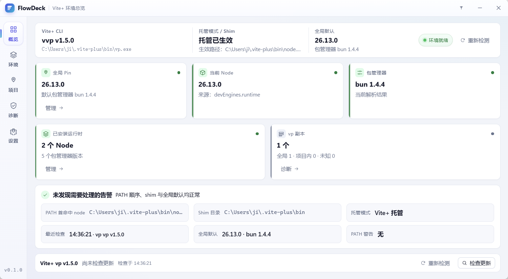
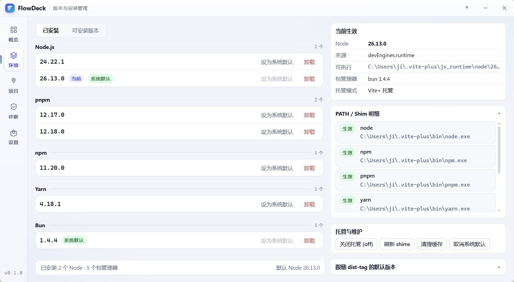
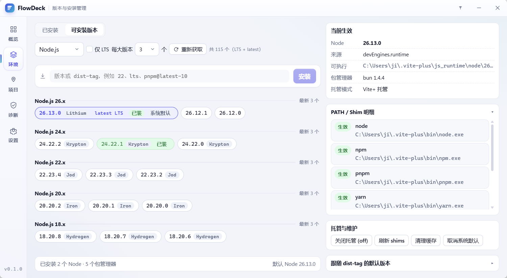
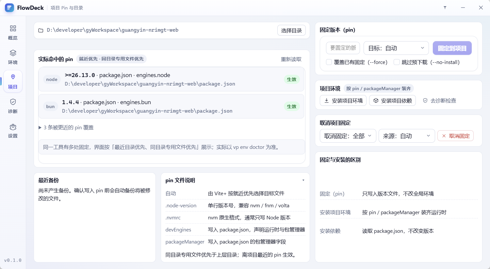
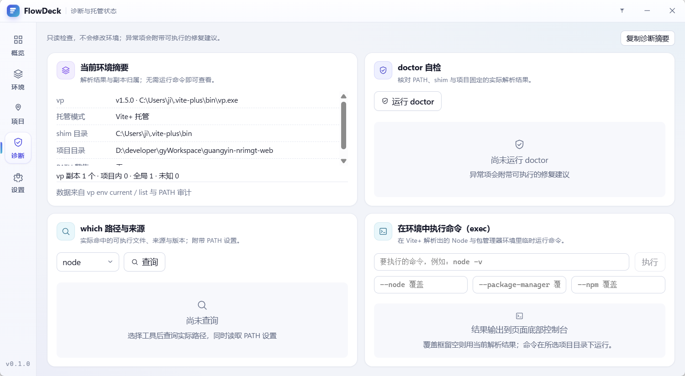
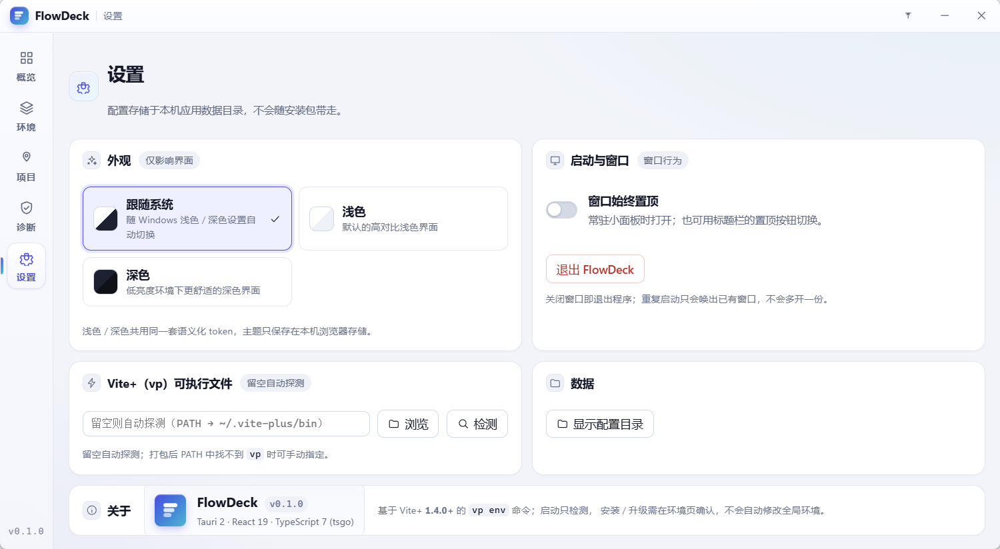

# FlowDeck

一个基于 **Tauri 2** 的 Windows 桌面常驻工具，专注 **Vite+ 环境管理**：版本安装与切换、项目 pin、托管模式、诊断，
固定 1200×660 小窗（不可缩放），支持窗口置顶与拖动移动。免安装，解压双击即用。

- 体积：单个 exe，约 1.5 MB，静态链接，除系统自带的 WebView2 外无外部依赖
- 数据：全部存在本机 `%APPDATA%\dev.flowdeck.app\config.json`，不联网上报
- 许可：MIT



## 目录

- [界面结构](#界面结构)
- [功能](#功能)
- [技术栈](#技术栈)
- [数据与配置](#数据与配置)
- [快速开始](#快速开始)
- [项目结构](#项目结构)
- [开发与调试](#开发与调试)
- [打包分发](#打包分发)
- [已知依赖问题](#已知依赖问题)

## 界面结构

```
┌──────────────────────────────────────────────────────────────┐
│ FlowDeck — 当前页副标题            置顶 － ×                  │  自绘标题栏（可拖拽）
├────┬─────────────────────────────────────────────────────────┤
│总览│                                                         │
│环境│                  环境管理内容区                          │
│项目│        （概览 · 环境 · 项目 · 诊断 · 设置）              │
│诊断│                                                         │
│设置│                                                         │
└────┴─────────────────────────────────────────────────────────┘
```

- `decorations: false` + 自绘标题栏：Logo / 标题 / 副标题在左，置顶、最小化、关闭在右
- 标题栏拖拽是自己实现的（没用 `data-tauri-drag-region`），避免拖到屏幕边缘时触发 Windows Aero Snap
  贴边分屏 / 最大化（窗口固定尺寸，分屏没有意义）
- 左侧**导航轨**常驻，五个入口直接对应环境管理的五个页面
- 窗口固定 **1200×660**（逻辑像素），不可缩放、不可最大化，启动居中；小屏或高缩放比下按工作区收缩，
  保证完整可见

## 功能

### 1. Vite+ 环境管理

基于 [Vite+ 的 `vp env` 命令族](https://viteplus.dev/guide/env)，**要求 Vite+ ≥ 1.5.0**。

启动自检（只读，不修改全局环境）：

- 未检测到 `vp`：只展示安装引导，不会自动执行安装脚本
- 已安装但版本低于 1.5.0：提示升级，需在环境页手动确认后才执行 `vp upgrade`
- 只有用户点击「自动安装 / 升级」时后端才允许写操作，安装 / 升级通过事件实时反馈阶段
- 若在设置里手动指定了 `vp` 路径但不可用，不会静默覆盖该配置，只提示修正

页面分四个分页（顶层导航另有设置页）：

| 分页       | 内容                                                                                                                                                                                  |
| ---------- | ------------------------------------------------------------------------------------------------------------------------------------------------------------------------------------- |
| 概览       | 当前解析出的 Node / 包管理器版本、node 可执行文件路径、项目根目录；提供「安装项目环境」「检查项目环境」；下面直接列出已安装的 Node 与各包管理器，每行可「设为系统默认」「固定到项目」 |
| 已安装     | 按 Node.js / pnpm / npm / Yarn / Bun 分组列出本机已装版本，就地设置默认值、卸载                                                                                                       |
| 可安装版本 | `vp env list-remote` 结果按**大版本分组**，每组默认展示前 6 组、组内按需渲染，标记 LTS / latest / 最新 LTS / 已装 / 系统默认 / 当前；拉取失败时回退上次缓存并标注时间                 |
| 更多工具   | `doctor` / `print` / `which` / `exec` / `clean` / `setup` / `unpin` / `default --unset` / `on` `off` / `pin` / `use`                                                                  |





项目页会只读解析 `.nvmcp` / `.node-version` / `.nvmrc` 与根 `package.json` 的 `engines` / `volta` /
`packageManager` / `devEngines`，展示实际命中值、生效层级、被覆盖项与冲突；pin / unpin 前给出文件级
diff 预览并自动备份到应用数据目录的 `pin-backups/`，目标文件位于项目目录之外时会明确标注为危险操作。



命令语义速查（界面里每条按钮都有对应说明）：

| 目的                       | 命令                                                                                                            |
| -------------------------- | --------------------------------------------------------------------------------------------------------------- |
| 按项目固定装齐环境         | `vp env install`（在项目目录执行，不带 spec）                                                                   |
| 全局切换默认版本           | `vp env default <spec>` / `--unset`                                                                             |
| 跟随 dist-tag 的默认值     | `vp env default lts` / `pnpm@latest-10`（每次解析重新取值，缓存 1 小时）                                        |
| 只锁定某个项目             | `vp env pin <spec> [--target auto\|node-version\|nvmrc\|dev-engines\|package-manager] [--force] [--no-install]` |
| 取消项目固定               | `vp env unpin [node\|pm\|<pm>] [--target <source>]`                                                             |
| 临时跑一条命令             | `vp env exec [--node <spec>] [--package-manager <spec>] [--npm <spec>] <command...>`                            |
| 托管 ↔ 系统优先            | `vp env on\|off [node\|pm\|pnpm\|npm\|yarn\|bun]`                                                               |
| 清理未使用安装             | `vp env clean [selector]`                                                                                       |
| 重建 shims / 只写 env 文件 | `vp env setup [--refresh] [--env-only]`                                                                         |

几处刻意的设计：

- **固定位置的语义按 Vite+ 1.5.0 执行**：Node 固定写入当前目录（`.node-version` / `.nvmrc` /
  `devEngines.runtime`），包管理器固定写入 **workspace 根 `package.json`**；在子包里操作时
  会改动上层文件，界面确认框与 tooltip 都明确提示
- **pin / unpin 的输出会保留在页面上**：1.4.0 起命令会报告改动的 `File:` / `Field:`，
  页面抽出这些关键行放在「最近操作」卡片里，不用翻整段终端输出
- **`which` / `print` / `doctor` 都带项目目录执行**，否则会忽略项目里的固定版本，只看到全局默认
- **Node.js 列表做了精简**：只保留 18 及以后的 LTS（18 / 20 / 22 / 24）与当前最新线（26.x），
  19 / 21 / 23 / 25 这类非 LTS 过渡线和 17 及更旧的版本不再展示，因此 Node 分页不提供「含全部历史版本」
- `--lts` **只对 Node.js 有效**（包管理器没有 LTS 概念，`vp env list-remote bun --lts` 会直接报错），
  切到包管理器时该选项自动禁用并复位；包管理器分页可选 `--all`
- **破坏性操作都有原生二次确认**：卸载版本、`vp env clean`、取消固定、清除默认，
  以及「固定到项目」可能覆盖已有 pin 时（勾选 `--force` 表示明确覆盖，不再询问）
- 所有命令输出实时回显在页面底部的「命令输出」终端面板
- 超时分级：读取类 30s、拉取远程列表 60s、install / uninstall / pin / clean / exec 等会联网的 300s，
  安装 / 升级 Vite+ 本身 900s；超时后终止**整个进程树**（Windows 用 `taskkill /T`）并在面板提示，
  不会把界面卡在 busy
- 自检与安装 / 升级在后端串行执行，避免两次安装脚本同时写同一个目录

### 2. 取消与诊断



- **真取消**：运行中的 `vp` 子进程会在后端注册 PID，点取消后终止**整个进程树**并确认退出；
  界面如实反馈是否仍有残留，残留时给出 `vp env list` / `vp env clean` 的后续建议
- **结构化诊断**：`doctor` 按检查项、`which` 按工具路径、`print` 按键值对展示，不再只丢原始文本；
  异常项附带可执行的修复建议，并可一键复制诊断摘要用于报障
- **安装体验**：安装过程按下载 / 解压 / 校验 / 安装分阶段展示；失败按网络 / 权限 / 磁盘 / 残留分类，
  支持一键清理后重试

### 3. 窗口形态：固定尺寸、置顶

- **单实例**：重复启动只唤出已有窗口，不会多开一份
- **关闭窗口**：直接退出程序，不驻留后台
- **固定尺寸**：1200×660，不可拖拽改大小、不可最大化；标题栏可拖动移动窗口，最小化 / 关闭正常
- **窗口置顶**：标题栏按钮切换，状态写入配置

### 4. 设置页



启动与窗口（窗口置顶）、`vp` 可执行文件路径（浏览 + 检测）、
显示并打开配置目录、关于信息。

## 技术栈

| 项       | 版本                                                              |
| -------- | ----------------------------------------------------------------- |
| 桌面框架 | Tauri 2.12.0（`tauri-build` 2.7.0）                               |
| 前端 IPC | `@tauri-apps/api` 2.12.1                                          |
| 插件     | `tauri-plugin-dialog` 2.8.0、`tauri-plugin-single-instance` 2.5.2 |
| 前端     | React 19.3.0 + Vite 8.3.4                                         |
| 语言     | TypeScript 7.0.2（原生 Go 版编译器 tsgo）                         |
| 工具链   | Rust 1.99.0 `stable-x86_64-pc-windows-msvc` · bun 1.4.2           |

> TypeScript 7.0.2 即 Go 原生编译器，npm 包名仍是 `typescript`，`bun run tsgo` 通过
> `node ./node_modules/typescript/bin/tsc` 调用内置二进制。
> 应用名与版本号只有一个出处：`package.json`，经 `src/lib/appMeta.ts` 读取，界面各处不再硬编码。

## 数据与配置

```json
{
  "vpPath": null,
  "lastProjectDir": null,
  "alwaysOnTop": false
}
```

- 路径：`%APPDATA%\dev.flowdeck.app\config.json`（macOS 为 `~/Library/Application Support/dev.flowdeck.app/`）
- 每次成功保存都会把上一份可解析配置备份为 `config.json.bak`；配置解析失败时进入恢复向导，
  不回退空配置、也不写盘，避免覆盖用户数据
- `vpPath` 留空时按顺序探测：**手动配置路径 → `VP_PATH` 环境变量 → `PATH` → 已知安装位置**
  （`~/.vite-plus/bin`、`%LOCALAPPDATA%\vite-plus\bin`、npm / pnpm 全局 bin 等）
- 纯 UI 状态存 `localStorage`，不进配置文件：`flowdeck.remote.<key>`（可安装版本列表的离线缓存）

## 快速开始

前置条件：bun、Rust stable（MSVC 工具链 + Windows SDK）、WebView2 运行时（Win10 1803+ / Win11 已内置）。
环境管理功能还要求本机装了 [Vite+](https://viteplus.dev/guide/)，否则该分页只显示安装引导。

```bash
bun install            # 安装依赖
bun run typecheck      # tsgo 类型检查
bun run dev            # 仅前端（配合 .scripts/mock-tauri.js 在浏览器里看样式）
bun run tauri:dev      # 开发模式（前端热重载 + Rust 重编译）
bun run tauri:build    # 一键打包：输出 dist-release/FlowDeck.exe（等同 package）
bun run package        # 一键打包：输出 dist-release/FlowDeck.exe
```

## 项目结构

```
src/
  App.tsx                    导航、视图切换、配置读写
  components/
    TitleBar.tsx             自绘标题栏 + 自定义拖拽（避开 Aero Snap）
    EnvManagerView.tsx       Vite+ 环境管理：概览 / 环境 / 项目 / 诊断
    SettingsView.tsx         设置页
    StatusCard.tsx           状态卡片
    OperationFeedback.tsx    操作反馈 / 进度（含阶段与取消）
    ConsolePanel.tsx         命令输出面板
    ConfigRecovery.tsx       配置损坏恢复向导
    EmptyState.tsx           空状态
    Toasts.tsx               通知
  lib/
    api.ts                   所有 Tauri command 的类型化封装
    version.ts               语义化版本比较与大版本分组
    spec.ts                  版本 spec 判定
    theme.ts                 主题模式
    appMeta.ts               应用元信息
src-tauri/
  src/lib.rs                 应用装配：窗口、单实例、命令注册、退出清理
  src/config.rs              config.json 结构与读写（原子写 + 备份 + 恢复）
  src/vp.rs                  vp 定位、命令封装、分级超时、进程树终止与取消、诊断解析
  src/pin.rs                 项目 pin 只读解析、diff 预览与备份
  tauri.conf.json            窗口与 bundle 配置
scripts/package.ts           一键打包（只产出 dist-release/FlowDeck.exe）
scripts/dev.ts               开发启动：动态端口 + devUrl 同步 + 拉起 tauri dev
scripts/dev-port.ts          从 1520 起探测可用端口
```

## 开发与调试

- **完整开发**：`bun run tauri:dev` 启动前先检测本项目是否已有实例——程序已运行时会尝试把已有窗口
  切到前台并退出（成功退出码 0；窗口无法激活或仍在启动时退出码 2，并提示从任务栏切换），**不会**起第二份
  Vite/Tauri；没有实例时从 1520 起自动探测可用端口，用临时 config 把端口同步给 Tauri 的 `devUrl`。
  被占用的端口会打印占用进程 PID 与命令行；端口在探测后被抢占时 Vite 会因 `strictPort` 显式失败并
  自动换下一个，连续 20 个端口都不可用则直接报错退出
- **单实例**：应用运行期由 `tauri-plugin-single-instance` 保证，重复启动会聚焦已有窗口而不是再起一个实例
- **前端单独跑**：`bun run dev` 起 Vite（默认 1520 `strictPort`，可用 `FLOWDECK_DEV_PORT` 指定）；纯浏览器下缺少 Tauri
  IPC，环境数据会停在空状态，完整功能请用 `bun run tauri:dev`
- **窗口行为只能手测**：置顶、拖动、最小化这类原生窗口行为在 WebView 里无法自动化，
  改完请实际拖一遍标题栏、点最小化 / 关闭，并确认拖动窗口不能改变尺寸
- **命令链路**：前端 `src/lib/api.ts` → `#[tauri::command]`（`src-tauri/src/lib.rs`）→ `vp.rs` / `pin.rs`；
  加一条 `vp` 命令时三处都要动，别在组件里直接写 `invoke("...")`
- Vite 的 `watch.ignored` 排除了 `src-tauri/**`，Rust 侧变更交给 tauri 自己触发重编译

## 打包分发

> 只分发**免安装绿色版**，不生成 NSIS 安装程序。

```bash
bun run package        # 推荐：= bun scripts/package.ts
bun run tauri:build    # 同上；两个命令产物一致
```

在 cmd、PowerShell、Git Bash 里都能直接跑，不依赖 Git Bash / shell 工具链。

脚本依次做：结束残留进程 → `tauri build --no-bundle`（只出裸 exe）→ 清理 `dist-release/`
→ 把唯一的可执行文件复制为 `dist-release/FlowDeck.exe`。全程不依赖 NSIS 工具链、不联网。

> 直接运行 `bun run tauri build --no-bundle` 或 `cargo build --release` 时，Tauri / Cargo 只会把
> 裸 exe 放在 `src-tauri/target/release/flowdeck.exe`，不会自动复制；要可分发产物请用上面两个命令。

产物只有一个文件：

| 文件                        | 用途                                                         |
| --------------------------- | ------------------------------------------------------------ |
| `dist-release/FlowDeck.exe` | 免安装绿色版，双击即用；只依赖系统自带的 **WebView2 运行时** |

`dist-release/` 里不会再有 zip、说明文件或子目录。不要外发的中间产物：
`src-tauri/target/**`（Rust 构建缓存，数百 MB，可随时删除，下次打包会重新生成）、
`node_modules/`（已打进 exe）、`flowdeck.pdb`（仅排查崩溃时用）。

## 已知依赖问题

两处已在仓库内修好，改动 `src-tauri/Cargo.toml` 前请先读注释：

1. **`indexmap` 缺 `std` feature**：`tauri-build` 依赖的 `schemars 0.8.22` 引入 `indexmap 1.x` 时
   未开启其 `std`，导致 `IndexMap<K, V>` 缺少默认泛型参数而无法编译。
   解决：显式声明 `indexmap = { version = "1.9", features = ["std"] }`，并用 `resolver = "1"`
   让 build-dependencies 与常规依赖共享 feature。
2. **`custom-protocol` feature 不能删**：`tauri-macros` 里 `dev = cfg!(not(feature = "custom-protocol"))`，
   没启用时 `generate_context!` 会去连 `devUrl`（localhost:1520 `dist/` 嵌进 exe，
   打包出来的程序没有 dev server 可连，窗口一片空白。

## 许可

MIT © jiyao — 详见 [LICENSE](LICENSE)。
